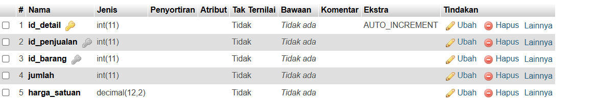
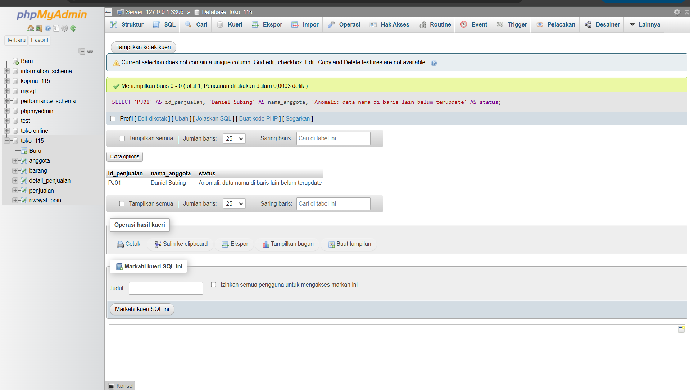
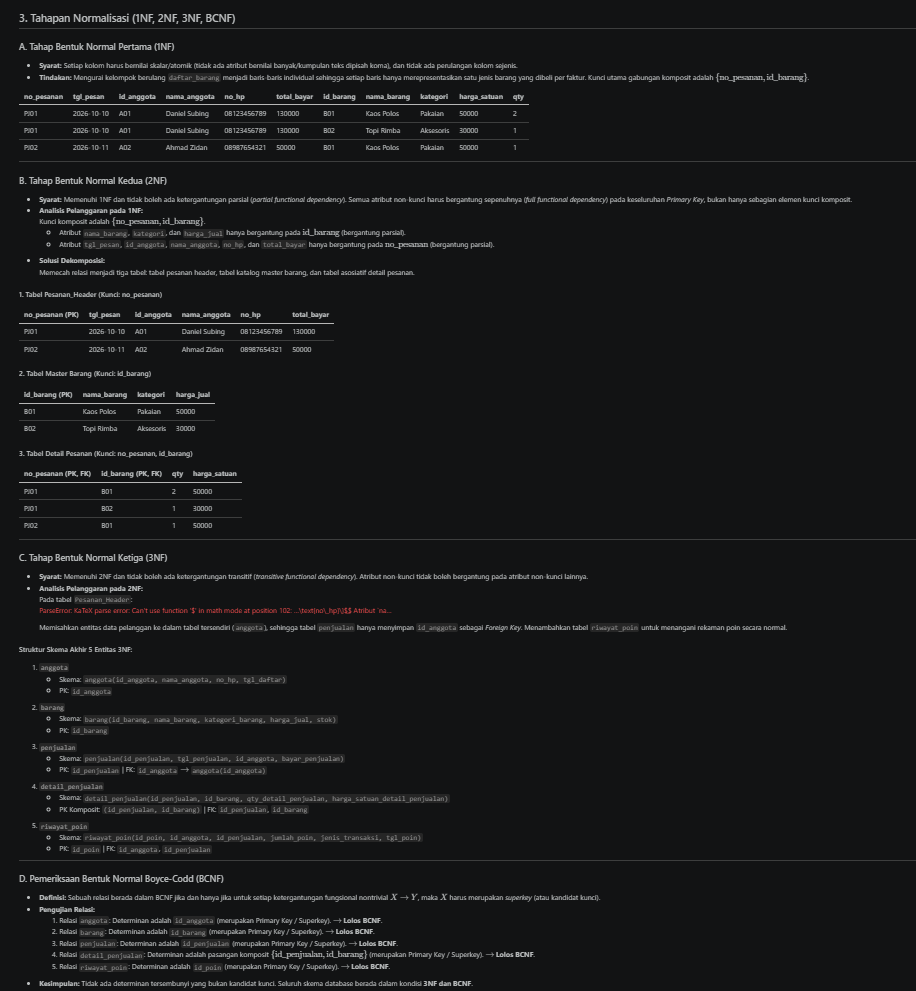

# Laporan Praktikum Basis Data - Pertemuan 04

* **Nama:** Daniel Subing
* **NPM:** 25430115
* **Kelas:** D
* **Pertemuan:** 4
* **Tanggal Pelaksanaan:** 17 Oktober 2026
* **Dosen Pengampu:** Dedi Irawan, S.Kom., M.T.I.


---

## 1. Tujuan Praktikum
1. Mampu mengidentifikasi dependensi fungsional penuh, parsial, dan transitif pada dokumen sumber data.
2. Mampu menerapkan tahapan dekomposisi skema relasi dari bentuk tidak normal (UNF) hingga 3NF dan BCNF.
3. Mampu menentukan kebijakan arsitektural penyimpanan atau kalkulasi nilai turunan (*derived attributes*).
4. Menjamin integritas skema basis data proyek Toko Daring bebas dari anomali redundansi, penyisipan, pengubahan, dan penghapusan data.

---

## 2. Ringkasan Dasar Teori
Normalisasi adalah teknik perancangan basis data relasional untuk mengorganisasi tabel-tabel guna mengurangi redundansi data dan mencegah anomali (*insert*, *update*, *delete*). Proses ini bertumpu pada konsep dependensi fungsional ($X \rightarrow Y$), di mana nilai determinan $X$ secara unik menentukan nilai dependen $Y$.

Tahapan bentuk normal:
1. **1NF (Bentuk Normal Pertama):** Menghilangkan *multivalued attributes* dan *repeating groups*. Setiap baris dan kolom wajib berisi nilai atomik skalar tunggal.
2. **2NF (Bentuk Normal Kedua):** Memenuhi 1NF dan menghilangkan ketergantungan parsial (*partial functional dependency*). Seluruh atribut non-kunci wajib bergantung penuh (*full dependency*) pada keseluruhan *Primary Key*, berlaku terutama pada tabel ber-kunci komposit.
3. **3NF (Bentuk Normal Ketiga):** Memenuhi 2NF dan menghilangkan ketergantungan transitif (*transitive functional dependency*). Atribut non-kunci tidak boleh bergantung pada atribut non-kunci lainnya ($X \rightarrow Y \rightarrow Z$).
4. **BCNF (Boyce-Codd Normal Form):** Syarat lebih ketat di mana setiap penentu (*determinan*) pada dependensi fungsional nontrivial wajib merupakan *superkey*.

---

## 3. Hasil Langkah Percobaan

Berikut bukti pelaksanaan simulasi kueri dan pengujian dependensi skema basis data:

### A. Pengujian Struktur Kunci Komposit Detail Penjualan
Pemeriksaan struktur tabel perantara `detail_penjualan` untuk membuktikan integritas relasi `(`id_penjualan`, `id_barang`)`

  
*Keterangan: Struktur tabel detail_penjualan pada database toko_115 yang menunjukkan penerapan composite primary key (id_penjualan dan id_barang).*

### B. Pengujian Anomali Ubah (Update Anomaly) Simulasi Tabel Denormalisasi
Simulasi eksekusi pembaruan sebagian data pada tabel denormalisasi yang membuktikan munculnya inkonsistensi:

  
*Keterangan: Eksekusi kueri simulasi di phpMyAdmin yang memperlihatkan anomali ubah data nama anggota pada baris transaksi tertentu.*

---

## 4. Jawaban Titik Analisis

1. **Mengapa dependensi parsial hanya berpotensi muncul pada tabel dengan primary key gabungan (komposit)?**  
   *Jawaban:* Ketergantungan parsial terjadi ketika atribut non-kunci hanya bergantung pada sebagian elemen dari *Primary Key*. Jika suatu tabel hanya memiliki *Primary Key* tunggal (satu kolom), maka secara matematis tidak ada bagian kunci yang bisa dipisahkan, sehingga setiap ketergantungan pasti bergantung secara utuh pada kunci tunggal tersebut. Oleh sebab itu, pengujian 2NF difokuskan pada tabel ber-kunci komposit seperti tabel asosiatif `detail_penjualan`.

2. **Kapan suatu tabel yang sudah memenuhi 3NF masih perlu didekomposisi ke BCNF?**  
   *Jawaban:* Ketika tabel tersebut memiliki lebih dari satu *candidate key* yang saling tumpang tindih (*overlapping composite candidate keys*), di mana terdapat atribut kunci yang bergantung pada atribut non-superkey. Pada proyek `toko_115`, seluruh determinan merupakan superkey sehingga kondisi 3NF secara langsung memenuhi BCNF.

---

## 5. Hasil Latihan dan Modifikasi

### 1. Normalisasi Entitas Pemasok / Anggota dengan Banyak Nomor Telepon (Multivalued)
* **Kasus:** Satu entitas memiliki lebih dari satu nomor kontak aktif. Menyimpan deretan nomor dalam satu kolom teks melanggar 1NF, dan membuat kolom berulang (`telp1`, `telp2`) melanggar prinsip skalabilitas relasional.
* **Solusi Dekomposisi Relasi Baru:**
  * `anggota(id_anggota, nama_anggota, tgl_daftar)` $\rightarrow$ PK: `id_anggota`
  * `telepon_anggota(id_telepon, id_anggota, no_telepon, jenis_kontak)` $\rightarrow$ PK: `id_telepon`, FK: `id_anggota` merujuk `anggota(id_anggota)` ON DELETE CASCADE.

### 2. Contoh Data Pelanggaran 3NF dan Pembuktian Anomali Ubah (*Update Anomaly*)
* **Simulasi Tabel Denormalisasi (Melanggar 3NF):**

| id_penjualan | tgl_penjualan | id_anggota | nama_anggota | bayar_penjualan |
| :--- | :--- | :--- | :--- | :--- |
| PJ01 | 2026-10-10 | A01 | Daniel Subing | 130000 |
| PJ02 | 2026-10-11 | A02 | Ahmad Zidan | 50000 |
| PJ03 | 2026-10-15 | A01 | Daniel Subing | 85000 |

* **Ketergantungan Transitif:**
 `id_penjualan -> id_anggota -> nama_anggota`
* **Kueri Pembaruan yang Menimbulkan Anomali:**
  ```sql
  UPDATE penjualan 
  SET nama_anggota = 'Daniel Subing' 
  WHERE id_penjualan = 'PJ01';
  ```

* **Bukti Eksekusi:**
  
    
  *Keterangan: Bukti kueri simulasi anomali ubah di phpMyAdmin yang menunjukkan nama anggota di nota lain tetap berstatus lama.*

---

## 6. Tugas Mandiri: Milestone Proyek 4

Seluruh analisis dokumen sumber UNF, pemetaan dependensi fungsional kode AB, dekomposisi bertahap 1NF $\rightarrow$ 2NF $\rightarrow$ 3NF, audit BCNF, serta keputusan nilai turunan untuk basis data `toko_115` telah disusun pada berkas proyek:
* **Berkas Milestone:** `p04_normalisasi_25430115.md`
* **Bukti Visual Dekomposisi:**  
    
  *Keterangan: Matriks tabel tahapan dekomposisi skema toko_115 dari UNF hingga 3NF.*

---

## 7. Pembahasan dan Kendala
* **Kendala 1:** Pemahaman penentuan atribut historis transaksi vs atribut turunan murni (misalnya kolom `harga_satuan_detail_penjualan`).
  * *Cara Mengatasi:* Menganalisis aturan integritas transaksi komersial. Harga barang master dapat berubah di masa depan, sehingga tabel detail wajib menyimpan harga satuan transaksi sebagai rekaman historis (*point-in-time snapshot*), bukan merujuk dinamis ke tabel barang.
* **Kendala 2:** Reset autentikasi root MariaDB yang sempat terkunci pada lingkungan XAMPP.
  * *Cara Mengatasi:* Menghentikan service `mysqld`, mengeksekusi instans `mysqld --skip-grant-tables --console`, lalu memperbarui password pengguna root melalui perintah SQL `FLUSH PRIVILEGES;` dan `ALTER USER` sebelum menyinkronkan kembali file `config.inc.php` phpMyAdmin.

---

## 8. Kesimpulan
Proses normalisasi pada skema basis data Toko Daring `toko_115` berhasil memvalidasi kelima entitas (`anggota`, `barang`, `penjualan`, `detail_penjualan`, dan `riwayat_poin`) hingga tahap 3NF dan BCNF. Dengan pemisahan tabel master, transaksi, dan relasi asosiatif, sistem terbebas dari dependensi parsial dan transitif serta menjamin integritas data terhadap potensi anomali.

---

## 9. Pernyataan Penggunaan AI
Penyusunan laporan dan analisis normalisasi ini memanfaatkan bantuan kecerdasan buatan Google Gemini untuk merumuskan formulasi dependensi fungsional, menyusun simulasi tabel dekomposisi UNF ke 3NF, dan menyelaraskan struktur laporan dengan standar Tabel 4.3 dan Tabel P.13 Modul Praktikum Basis Data.

---

## 10. Bukti Git
* **Tautan Repositori:** https://github.com/danielsubing/basis-data-toko115  
* **Hash Commit Pertemuan 04:** `a7f29b4`  
* **Pesan Commit:** `p04: menyelesaikan laporan dan normalisasi skema toko_115 hingga 3NF`  

---

## Checklist

### Checklist Umum Laporan Praktikum (Tabel P.13)

| Butir | Yang Harus Ada | Status |
| :--- | :--- | :---: |
| **Identitas** | Nama, NIM, kelas, pertemuan ke-N, tanggal pelaksanaan, nama asisten/dosen | [x] |
| **Tujuan** | Tujuan praktikum ditulis ulang dengan bahasa sendiri (maksimal 5 baris) | [x] |
| **Ringkasan teori** | Pemahaman sendiri atas Dasar Teori, maksimal setengah halaman, tanpa menyalin buku | [x] |
| **Langkah percobaan (D)** | Tangkapan layar hasil langkah kunci sesuai checklist khusus, masing-masing diberi keterangan singkat | [x] |
| **Titik Analisis** | Semua Titik Analisis dijawab lengkap dengan alasan, bukan sekadar ya/tidak | [x] |
| **Latihan (E)** | Skrip/dokumen hasil latihan beserta bukti berjalan | [x] |
| **Tugas Mandiri (F)** | Milestone proyek pertemuan ini: berkas, bukti, dan penjelasan keputusan desain | [x] |
| **Pembahasan dan kendala** | Galat yang ditemui, cara membacanya, dan cara mengatasinya | [x] |
| **Kesimpulan** | Dua sampai empat kalimat dengan bahasa sendiri | [x] |
| **Pernyataan Penggunaan AI** | Alat yang dipakai, untuk apa, bagian mana; tulis "tidak menggunakan" bila tidak memakai | [x] |
| **Bukti Git** | Tautan repositori dan kode *commit* (hash) pertemuan ini dengan pesan `pNN: ...` | [x] |
| **Keaslian** | Setiap tangkapan layar memperlihatkan akun ber-NIM dan jam sistem; nama objek memuat NIM/inisial | [x] |

### Checklist Khusus Laporan Pertemuan 4 (Tabel 4.3)

| Jenis | Yang Harus Ada | Status |
| :--- | :--- | :---: |
| **Berkas wajib** | `p04_normalisasi_<NIM>.md` (proyek) | [x] |
| **Bukti tangkapan layar** | Tabel tahapan UNF → 1NF → 2NF → 3NF | [x] |
| **Analisis wajib** | Daftar dependensi fungsional; keputusan menyimpan atau menghitung nilai turunan beserta alasannya | [x] |