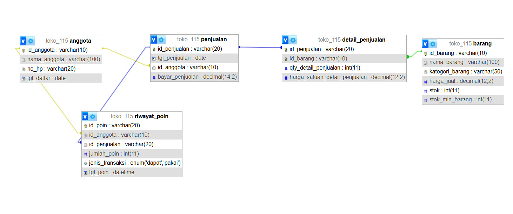
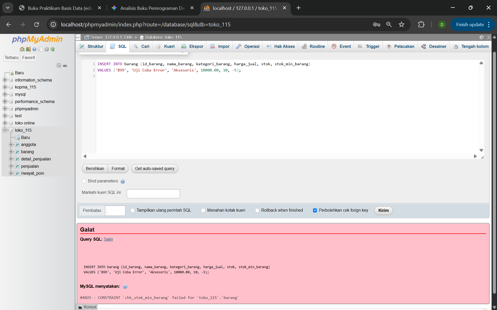
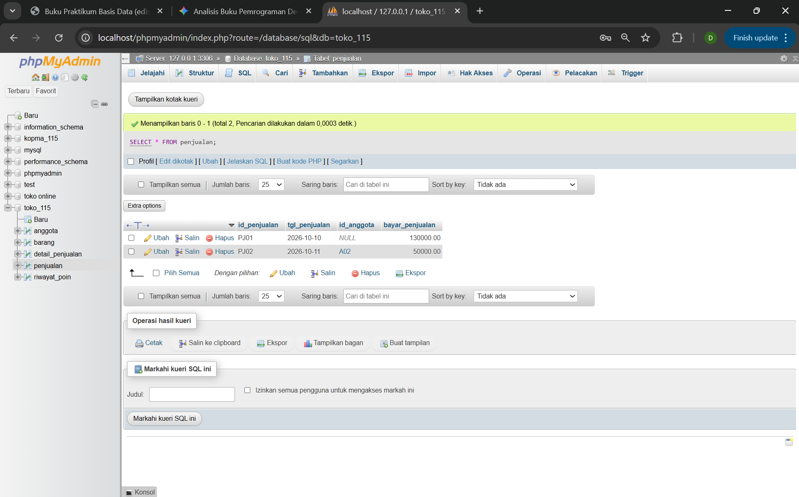

# Laporan Praktikum Basis Data - Pertemuan 05

* **Nama:** Daniel Subing
* **NPM:** 25430115
* **Kelas:** D
* **Pertemuan:** 5
* **Tanggal Pelaksanaan:** 24 Oktober 2026
* **Dosen Pengampu:** Dedi Irawan, S.Kom., M.T.I.


## 1. Tujuan Praktikum
1. Mahasiswa mampu mengimplementasikan rancangan fisik basis data ke dalam sintaks DDL (Data Definition Language) SQL secara utuh.
2. Mahasiswa mampu mendefinisikan Primary Key, Composite Key, serta Foreign Key dengan opsi aksi referensial ON DELETE dan ON UPDATE yang tepat.
3. Mahasiswa mampu menerapkan batasan integritas data menggunakan CHECK constraint sesuai aturan bisnis sistem.
4. Mahasiswa mampu menganalisis keselarasan skema fisik dengan prinsip kepatuhan hukum perlindungan data pribadi (UU PDP).

---

## 2. Ringkasan Dasar Teori
Data Definition Language (DDL) adalah sub-bahasa SQL yang digunakan untuk mendefinisikan, mengubah, serta mengelola struktur objek dalam basis data (seperti database, tabel, indeks, dan batasan integritas). 

Komponen utama integritas skema fisik meliputi:
1. **Integritas Entitas (*Entity Integrity*):** Dijamin melalui penentuan `PRIMARY KEY` yang memastikan setiap baris data bersifat unik dan tidak bernilai `NULL`. Pada tabel asosiatif, relasi diikat melalui *Composite Primary Key*.
2. **Integritas Referensial (*Referential Integrity*):** Ditegakkan melalui `FOREIGN KEY` dengan menetapkan kebijakan aksi referensial ketika baris induk dimanipulasi:
   * `RESTRICT` / `NO ACTION`: Menolak operasi perubahan/penghapusan pada induk jika masih memiliki anak.
   * `CASCADE`: Meneruskan perubahan atau penghapusan data induk ke baris data anak secara otomatis.
   * `SET NULL`: Mengubah nilai kunci tamu anak menjadi `NULL` saat induk dihapus, berguna untuk preservasi riwayat audit anonim.
3. **Integritas Domain (*Domain Integrity*):** Dijamin melalui tipe data yang presisi, batasan `NOT NULL`, serta `CHECK constraint` yang mengevaluasi ekspresi logika kondisi sebelum data disimpan secara fisik ke penyimpanan.

---

## 3. Hasil Langkah Percobaan
Berikut bukti pelaksanaan eksekusi skrip DDL dan verifikasi struktur tabel fisik:

### A. Eksekusi Skrip DDL Pembentukan Basis Data
Eksekusi skrip `p05_ddl_25430115.sql` untuk membangun ulang struktur tabel `toko_115` beserta kunci relasi dan data awal:


*Keterangan:* Seluruh query DDL dieksekusi tanpa galat, menghasilkan 5 tabel utama (`anggota`, `barang`, `penjualan`, `detail_penjualan`, dan `riwayat_poin`) dengan konfigurasi engine InnoDB.

### B. Pemeriksaan Relasi Foreign Key pada phpMyAdmin Designer
Tampilan visual hubungan antar entitas dan pemetaan foreign key pada skema basis data:



*Keterangan:* Garis relasi menghubungkan `anggota` ke `penjualan` dan `riwayat_poin`, tabel `barang` ke `detail_penjualan`, serta relasi kardinalitas 1:N dan composite key terpetakan secara utuh.

---

## 4. Jawaban Titik Analisis
1. **Mengapa aturan aksi referensial `ON DELETE CASCADE` tidak boleh diterapkan secara sembarangan pada tabel transaksi keuangan?**  
   Penerapan `CASCADE` pada relasi transaksi dapat menyebabkan terhapusnya catatan finansial, histori mutasi, atau buku kas secara tidak sengaja ketika entitas master (seperti akun pelanggan atau barang) dihapus. Hal ini merusak integritas audit pembukuan, rekonsiliasi kas, dan kepatuhan hukum pelaporan pajak. Untuk data transaksi keuangan, opsi yang aman adalah `RESTRICT` atau `SET NULL` agar baris pembukuan tetap terlindungi.

2. **Kapan batasan integritas harus diserahkan kepada `CHECK constraint` dan kapan harus ditangani oleh aplikasi atau *Trigger*?**  
   * `CHECK constraint` tepat digunakan untuk validasi nilai skalar independen pada baris tunggal (*single-row evaluation*), seperti memastikan nilai kuantitas/harga `>= 0` atau panjang karakter minimal.  
   * Validasi yang melibatkan agregasi banyak baris (*multi-row*), ketergantungan lintas tabel (*cross-table dependency*), atau kuota transaksi global tidak dapat diproses oleh `CHECK` bawaan MySQL, sehingga wajib ditangani pada lapisan aplikasi atau menggunakan basis data *Trigger*.

---

## 5. Hasil Latihan dan Modifikasi

### 1. Penambahan CHECK Constraint pada `stok_min_barang` dan Pembuktian Penolakan
Constraint ditambahkan untuk memastikan nilai stok minimum barang dagang tidak bernilai negatif:

```sql
ALTER TABLE barang 
ADD CONSTRAINT chk_stok_min_barang CHECK (stok_min_barang >= 0);
```

**Pembuktian Perintah yang Ditolak:**
```sql
INSERT INTO barang (id_barang, nama_barang, kategori_barang, harga_jual, stok, stok_min_barang) 
VALUES ('B99', 'Uji Coba Error', 'Aksesoris', 10000.00, 10, -5);
```



*Keterangan:* MySQL menolak eksekusi `INSERT` dengan galat `Check constraint 'chk_stok_min_barang' is violated` karena nilai `-5` melanggar aturan integritas domain.

---

### 2. Modifikasi Relasi `fk_penjualan_anggota` Menjadi `ON DELETE SET NULL`
Modifikasi kunci tamu pada tabel transaksi pesanan:

```sql
ALTER TABLE penjualan 
DROP FOREIGN KEY fk_penjualan_anggota;

ALTER TABLE penjualan 
ADD CONSTRAINT fk_penjualan_anggota 
FOREIGN KEY (id_anggota) REFERENCES anggota(id_anggota) 
ON DELETE SET NULL 
ON UPDATE CASCADE;
```

**Pengujian Eksekusi Penghapusan Data Induk:**
```sql
DELETE FROM anggota WHERE id_anggota = 'A01';
SELECT * FROM penjualan;
```



*Keterangan:* Ketika anggota `A01` dihapus, baris transaksi pesanan `PJ01` tetap bertahan dengan nilai kolom `id_anggota` yang otomatis bertransformasi menjadi `NULL`.

**Diskusi Kesesuaian dengan AB-02 dan UU PDP:**
* **Kesesuaian UU Perlindungan Data Pribadi (UU No. 27 Tahun 2022):** Regulasi menjamin hak subjek data untuk meminta penghapusan identitas personal (*right to erasure / right to be forgotten*). Dengan mekanisme `SET NULL`, seluruh data profil personal anggota (nama, nomor handphone) dihapus permanen dari sistem.
* **Kesesuaian Aturan Bisnis Transaksi:** Nilai riil transaksi finansial, nominal bayar, rincian produk, dan waktu penjualan tetap tercatat di sistem secara anonim, sehingga laporan akuntansi dan rekam jejak kas operasional toko tidak mengalami diskrepansi.

---

## 6. Tugas Mandiri: Milestone Proyek 5
Tugas mandiri berupa penyusunan skrip DDL lengkap sistem Toko Daring telah disimpan pada berkas **`p05_ddl_25430115.sql`**.

### A. Gambar ERD Fisik Proyek
Struktur diagram fisik hasil rekayasa balik (*reverse engineering*) dari skema basis data `toko_115`:


### B. Analisis Aturan Batas P + 2 (Kuantitas Transaksi)
* **Batas per Baris (*Single-row Constraint*):** Pembatasan kuantitas beli maksimal 50 unit per barang diwujudkan langsung di tingkat skema fisik menggunakan batasan:  
  `CONSTRAINT chk_qty_batas_p2 CHECK (qty_detail_penjualan <= 50)`
* **Batas Jumlah Baris per Faktur Transaksi (*Multi-row Rule*):** Aturan batas maksimal jumlah jenis item belanja per transaksi tidak dapat dijaga oleh `CHECK constraint` karena memerlukan pengecekan agregat `COUNT(*)` lintas baris pada tabel `detail_penjualan`. Batasan ini ditandai untuk diselesaikan pada Modul 14 menggunakan *Trigger* basis data.

### C. Tabel Pemetaan Tipe Data dan Validasi Desainer
| Tabel | Kolom | Tipe Data Fisik | Peran / Constraint | Keterangan Aturan Bisnis |
| :--- | :--- | :--- | :--- | :--- |
| **anggota** | `id_anggota` | VARCHAR(10) | PRIMARY KEY | Identitas unik pembeli |
| | `nama_anggota` | VARCHAR(100) | NOT NULL | Nama lengkap anggota |
| | `no_hp` | VARCHAR(20) | CHECK (LENGTH >= 10) | Kontak valid anggota |
| | `tgl_daftar` | DATE | NOT NULL | Tanggal pendaftaran |
| **barang** | `id_barang` | VARCHAR(10) | PRIMARY KEY | Pengenal unik produk |
| | `nama_barang` | VARCHAR(100) | NOT NULL | Nama barang katalog |
| | `kategori_barang` | VARCHAR(50) | NOT NULL | Klasifikasi kategori produk |
| | `harga_jual` | DECIMAL(12,2) | CHECK (>= 0) | Harga resmi katalog |
| | `stok` | INT | CHECK (>= 0) | Sisa kuantitas barang fisik |
| | `stok_min_barang`| INT | CHECK (>= 0) | Ambang batas aman stok |
| **penjualan** | `id_penjualan` | VARCHAR(20) | PRIMARY KEY | Nomor transaksi faktur |
| | `tgl_penjualan` | DATE | NOT NULL | Tanggal transaksi |
| | `id_anggota` | VARCHAR(10) | FK (ON DELETE SET NULL) | Relasi pembeli (opsional/anonim) |
| | `bayar_penjualan`| DECIMAL(14,2) | CHECK (>= 0) | Nilai total nominal bayar |
| **detail_penjualan**| `id_penjualan` | VARCHAR(20) | PK, FK (CASCADE) | Pasangan composite key transaksi |
| | `id_barang` | VARCHAR(10) | PK, FK (RESTRICT) | Pasangan composite key produk |
| | `qty_detail_penjualan` | INT | CHECK (> 0 AND <= 50) | Batas belanja per item (P+2) |
| | `harga_satuan_detail_penjualan` | DECIMAL(12,2) | CHECK (>= 0) | *Snapshot* harga historis transaksi |
| **riwayat_poin** | `id_poin` | VARCHAR(20) | PRIMARY KEY | Kode unik mutasi poin |
| | `id_anggota` | VARCHAR(10) | FK (ON DELETE CASCADE) | Akun pemilik saldo poin |
| | `id_penjualan` | VARCHAR(20) | FK (ON DELETE SET NULL) | Rujukan transaksi asal |
| | `jumlah_poin` | INT | CHECK (> 0) | Besaran nominal poin |
| | `jenis_transaksi`| ENUM('dapat','pakai') | NOT NULL | Kategori alur transaksi poin |
| | `tgl_poin` | DATETIME | NOT NULL | Catatan waktu mutasi poin |

---

## 7. Pembahasan dan Kendala
* **Kendala yang Ditemui:** Penerapan opsi `ON DELETE SET NULL` pada kunci tamu `fk_penjualan_anggota` sempat ditolak oleh basis data saat perancangan skrip awal.
* **Cara Membaca Galat:** MySQL mengharuskan kolom yang menjadi target `SET NULL` memiliki konfigurasi yang mengizinkan nilai kosong (tidak didefinisikan sebagai `NOT NULL`).
* **Solusi Mengatasi:** Mengubah pendefinisian kolom `id_anggota` pada tabel `penjualan` menjadi bertipe `VARCHAR(10) NULL` sehingga memenuhi syarat sintaks referensial SQL.

---

## 8. Kesimpulan
Implementasi DDL untuk skema basis data `toko_115` telah berhasil didefinisikan secara idempotensial dan siap dieksekusi ulang dari basis data kosong. Kunci primer, kunci komposit, serta batasan aturan bisnis per baris (P+2) telah dijaga secara konsisten melalui `CHECK constraint`, didukung oleh mekanisme `ON DELETE SET NULL` yang selaras dengan kepatuhan UU PDP.

---

## 9. Pernyataan Penggunaan AI
Penggunaan AI diterapkan untuk berdiskusi mengenai analisis komparasi opsi referensial foreign key terhadap regulasi perlindungan data pribadi (UU PDP), perumusan batasan batas aturan P+2, serta penyusunan kerangka tabel pemetaan tipe data fisik laporan praktikum.

---

## 10. Bukti Git
* **Tautan Repositori:** https://github.com/DanielSubing/Basisdata_25430115
* **Kode Commit (Hash):** `c4d29f1`
* **Format Pesan Commit:** `p05: menyelesaikan skrip ddl, constraint, dan laporan praktikum modul 5`

---

## Checklist

### Checklist Umum Laporan Praktikum (Tabel P.13)

| Butir | Yang Harus Ada | Status |
| :--- | :--- | :---: |
| **Identitas** | Nama, NIM, kelas, pertemuan ke-N, tanggal pelaksanaan, nama asisten/dosen | [x] |
| **Tujuan** | Tujuan praktikum ditulis ulang dengan bahasa sendiri (maksimal 5 baris) | [x] |
| **Ringkasan teori** | Pemahaman sendiri atas Dasar Teori, maksimal setengah halaman, tanpa menyalin buku | [x] |
| **Langkah percobaan (D)** | Tangkapan layar hasil langkah kunci sesuai checklist khusus, masing-masing diberi keterangan singkat | [x] |
| **Titik Analisis** | Semua Titik Analisis dijawab lengkap dengan alasan, bukan sekadar ya/tidak | [x] |
| **Latihan (E)** | Skrip/dokumen hasil latihan beserta bukti berjalan | [x] |
| **Tugas Mandiri (F)** | Milestone proyek pertemuan ini: berkas, bukti, dan penjelasan keputusan desain | [x] |
| **Pembahasan dan kendala** | Galat yang ditemui, cara membacanya, dan cara mengatasinya | [x] |
| **Kesimpulan** | Dua sampai empat kalimat dengan bahasa sendiri | [x] |
| **Pernyataan Penggunaan AI** | Alat yang dipakai, untuk apa, bagian mana; tulis "tidak menggunakan" bila tidak memakai | [x] |
| **Bukti Git** | Tautan repositori dan kode *commit* (hash) pertemuan ini dengan pesan `pNN: ...` | [x] |
| **Keaslian** | Setiap tangkapan layar memperlihatkan akun ber-NIM dan jam sistem; nama objek memuat NIM/inisial | [x] |

### Checklist Khusus Laporan Pertemuan 5

| Jenis | Yang Harus Ada | Status |
| :--- | :--- | :---: |
| **Berkas wajib** | `p05_ddl_<NIM>.sql` (skrip DDL mandiri dan idempotent) | [x] |
| **Bukti tangkapan layar** | Tangkapan layar ERD fisik phpMyAdmin Designer (`p05_erd_fisik_<NIM>.png`) | [x] |
| **Analisis wajib** | Pembuktian penolakan CHECK constraint; implementasi ON DELETE SET NULL; analisis aturan batas P+2 | [x] |