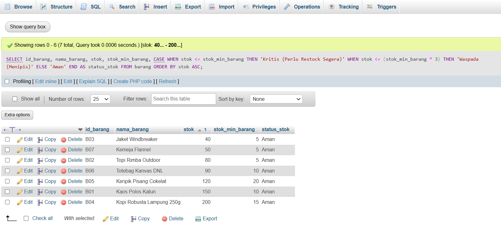
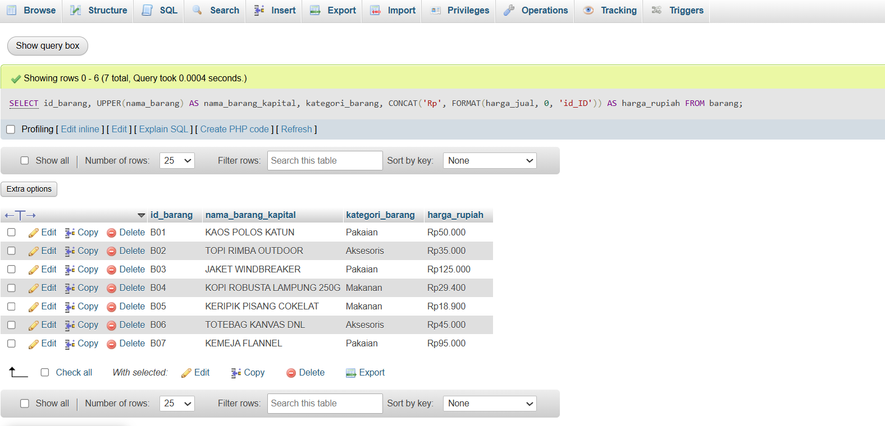
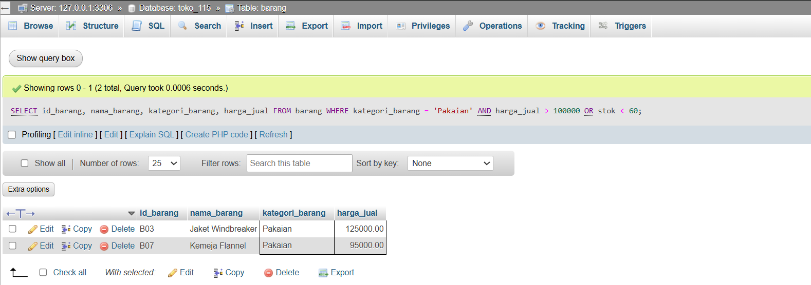
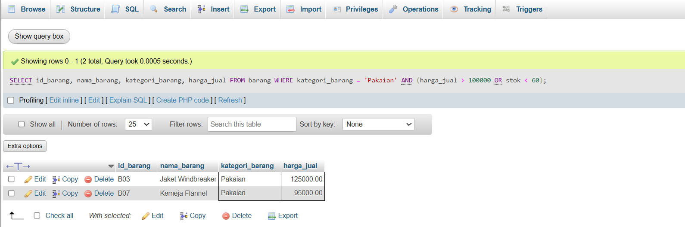

# Laporan Praktikum Basis Data - Pertemuan 07

* **Nama:** Daniel Subing
* **NPM:** 25430115
* **Kelas:** D
* **Pertemuan:** 7
* **Tanggal Pelaksanaan:** 1 November 2026
* **Dosen Pengampu:** Dedi Irawan, S.Kom., M.T.I.


## 1. Tujuan Praktikum

1. Mahasiswa mampu menyusun kueri seleksi data tingkat dasar hingga menengah pada satu tabel (*single-table queries*) menggunakan klausa `WHERE`, operator logika, dan fungsi pembanding SQL.
2. Mahasiswa mampu mengimplementasikan operator pola dan rentang seperti `LIKE`, `BETWEEN`, `IN`, serta pengecekan nilai kosong `IS NULL`.
3. Mahasiswa mampu menerapkan fungsi bawaan (*built-in functions*) manipulasi string, pemformatan tanggal, dan logika percabangan kondisional `CASE ... WHEN`.
4. Mahasiswa mampu menganalisis kesalahan semantik akibat presedensi operator logika (`AND` vs `OR`) serta membedakan Kebutuhan Informasi (KI) yang dapat diselesaikan pada satu tabel versus yang membutuhkan relasi multi-tabel (*JOIN*).

## 2. Ringkasan Dasar Teori

Kueri seleksi data merupakan fondasi dalam manipulasi informasi pada Sistem Manajemen Basis Data Relasional (RDBMS). Eksekusi kueri satu tabel berfokus pada pemfilteran baris (*horizontal filtering*) dan pemilihan atribut (*vertical projection*) secara terarah.

Komponen utama kueri satu tabel meliputi:
1. **Operator Penyaringan Nilai:**
   * `BETWEEN ... AND ...`: Menyaring nilai dalam rentang inklusif.
   * `IN (...)`: Menguji kesesuaian nilai terhadap sekumpulan himpunan diskrit.
   * `IS NULL` / `IS NOT NULL`: Menguji keberadaan nilai tak terdefinisi (*missing value*), yang tidak dapat diperiksa menggunakan operator aritmatika biasa (`=`).
2. **Pencarian Pola Teks (`LIKE`):**  
   Menggunakan karakter *wildcard* seperti `%` (mewakili sembarang nol atau lebih karakter) dan `_` (mewakili tepat satu karakter) untuk mendeteksi substring dalam kolom teks.
3. **Ekspresi Kondisional (`CASE`):**  
   Menyediakan percabangan logika di tingkat kueri untuk mengelompokkan atau mengonversi data mentah menjadi kategori bisnis baru tanpa mengubah data fisik di tabel.
4. **Presedensi Operator Logika:**  
   Operator logika `AND` memiliki prioritas eksekusi lebih tinggi dibandingkan operator `OR`. Tanpa penggunaan tanda kurung pengelompokan `()`, evaluasi kondisi majemuk dapat menghasilkan kesalahan semantik (*semantic error*), yaitu kueri berjalan sukses tanpa galat sintaks namun mengembalikan himpunan data yang keliru.

## 3. Hasil Langkah Percobaan

Berikut dokumentasi hasil pelaksanaan eksekusi kueri pada basis data `toko_115`:

### A. Eksekusi Kueri Seleksi Satu Tabel (Status Stok Barang)

Penerapan ekspresi kondisional `CASE` untuk memetakan status ketersediaan barang fisik terhadap stok minimum:



*Keterangan Gambar:* phpMyAdmin mengeksekusi kueri klasifikasi stok dengan membagi kondisi stok ke dalam label 'Kritis', 'Waspada', dan 'Aman' berdasarkan perbandingan nilai terhadap `stok_min_barang` secara akurat.

## 4. Jawaban Titik Analisis

1. **Mengapa kondisi perbandingan nilai kosong `WHERE id_anggota = NULL` tidak menghasilkan data apa pun (selalu false)?**  
   Dalam standar ANSI SQL, `NULL` bukan merupakan sebuah nilai skalar, melainkan penanda ketiadaan nilai (*unknown value* / ketiadaan data). Segala bentuk operasi perbandingan perataan seperti `= NULL` atau `!= NULL` akan menghasilkan evaluasi logika bernilai `UNKNOWN` (bukan `TRUE`). Oleh sebab itu, SQL mewajibkan penggunaan operator khusus `IS NULL` atau `IS NOT NULL` untuk mengevaluasi kolom yang kosong.

2. **Bagaimana urutan presedensi operator logika memengaruhi interpretasi klausa WHERE yang memuat operator AND dan OR secara bersamaan?**  
   SQL mengevaluasi operator `AND` terlebih dahulu sebelum mengevaluasi operator `OR` (mirip operasi perkalian terhadap penjumlahan). Jika sebuah klausa ditulis `WHERE A AND B OR C`, sistem akan memperlakukannya sebagai `WHERE (A AND B) OR C`. Akibatnya, baris data yang hanya memenuhi kriteria `C` akan otomatis lolos seleksi meskipun sama sekali tidak memenuhi kriteria `A`. Untuk memaksakan evaluasi `OR` dilakukan lebih awal, penulisan wajib menggunakan tanda kurung: `WHERE A AND (B OR C)`.

## 5. Hasil Latihan dan Modifikasi

### 1. Latihan E.1: Pemformatan Huruf Kapital dan Format Rupiah

Kueri untuk mengubah nama barang ke huruf besar serta memformat harga menjadi format mata uang Indonesia ("Rp4.000"):

```sql
SELECT 
    id_barang,
    UPPER(nama_barang) AS nama_barang_kapital,
    kategori_barang,
    CONCAT('Rp', FORMAT(harga_jual, 0, 'id_ID')) AS harga_rupiah
FROM barang;
```



*Keterangan Gambar:* Fungsi `UPPER()` berhasil mengubah string nama produk menjadi kapital penuh, dan kombinasi `CONCAT()` dengan `FORMAT(..., 0, 'id_ID')` menghasilkan format moneter sesuai kaidah lokal dengan pemisah ribuan titik.

### 2. Latihan E.2: Analisis Kueri Salah Semantik dan Perbaikannya

* **Kueri Salah Semantik (Tanpa Tanda Kurung):**  
  Kasus bisnis: Ingin menampilkan barang berkategori **Pakaian** yang harganya di atas Rp 100.000 ATAU stoknya di bawah 60 unit.

  ```sql
  SELECT id_barang, nama_barang, kategori_barang, harga_jual, stok
  FROM barang
  WHERE kategori_barang = 'Pakaian' AND harga_jual > 100000 OR stok < 60;
  ```

  

  *Keterangan Masalah:* Kueri tetap berjalan tanpa galat sintaks, namun barang non-pakaian (seperti *Aksesoris* yang stoknya < 60) ikut tampil karena MySQL mengevaluasi `(kategori_barang = 'Pakaian' AND harga_jual > 100000)` sebagai satu blok terpisah dari `OR stok < 60`.

* **Kueri yang Diperbaiki (Menggunakan Tanda Kurung Pengelompokan):**

  ```sql
  SELECT id_barang, nama_barang, kategori_barang, harga_jual, stok
  FROM barang
  WHERE kategori_barang = 'Pakaian' AND (harga_jual > 100000 OR stok < 60);
  ```

  

  *Keterangan Perbaikan:* Penambahan tanda kurung `(harga_jual > 100000 OR stok < 60)` memastikan penyaringan kategori 'Pakaian' menjadi syarat mutlak, sehingga data non-pakaian langsung tereliminasi dan hasil kueri sesuai dengan maksud bisnis sesungguhnya.

## 6. Tugas Mandiri: Milestone Proyek 7

Berkas skrip kueri mandiri telah disimpan pada direktori kerja proyek dengan nama **`p07_kueri_25430115.sql`**.

### Ringkasan Pemenuhan Kebutuhan Informasi (10 Kueri Satu Tabel)

| No | Kode KI | Ringkasan Pertanyaan Bisnis | Syarat Modul Terpenuhi | Ekspektasi Luaran |
|---|---|---|---|---|
| 1 | **KI-01** | Cari produk pakaian dengan kata kunci 'Kaos' atau 'Flannel' | `LIKE`, Fungsi String | Menampilkan produk pakaian yang cocok pola |
| 2 | **KI-02** | Filter barang harga jual menengah Rp 30.000 s/d Rp 100.000 | `BETWEEN` | Daftar produk ekonomis-menengah |
| 3 | **KI-03** | Tampilkan produk kelompok 'Aksesoris' atau 'Makanan' | `IN` | Baris produk kategori terkait |
| 4 | **KI-04** | Audit transaksi tanpa ID anggota (UU PDP / Pembeli Tamu) | `IS NULL` | Riwayat penjualan dengan ID anggota kosong |
| 5 | **KI-05** | Klasifikasikan tingkat kritis stok fisik barang | `CASE` | Status stok: Kritis, Waspada, atau Aman |
| 6 | **KI-06** | Rekap transaksi penjualan periode Oktober 2026 nominal besar | Fungsi Tanggal (`YEAR`, `MONTH`) | Penjualan periode target >= Rp 100.000 |
| 7 | **KI-07** | Standardisasi format teks nama kapital & panjang digit no HP | `UPPER`, `CONCAT`, `LENGTH` | Profil anggota dengan format standar |
| 8 | **KI-08** | Hitung durasi masa aktif keanggotaan pelanggan (hari) | `DATEDIFF`, `CURDATE` | Kolom lama bergabung dalam satuan hari |
| 9 | **KI-09** | Filter transaksi grosir/volume belanja tinggi (qty >= 3) | Operator Logika & Perbandingan | Detail pesanan dengan subtotal belanja |
| 10 | **KI-10** | Pengelompokan reward poin loyalitas (Platinum/Gold/Standar) | `CASE`, Relasional | Label mutasi reward per transaksi |

### Identifikasi Kebutuhan Informasi (KI) yang Membutuhkan Multi-Tabel

1. **KI-BELUM-01 (Rekap Belanja per Nama Pelanggan):**  
   *Alasan:* Informasi nama pelanggan berada di tabel `anggota`, sedangkan nilai belanja berada di tabel `penjualan`. Perlu relasi `JOIN` antara kedua tabel tersebut.
2. **KI-BELUM-02 (Rincian Nama Barang pada Setiap Faktur Transaksi):**  
   *Alasan:* Tabel `detail_penjualan` hanya menyimpan foreign key `id_barang`. Untuk menampilkan atribut deskriptif seperti `nama_barang` dan `kategori_barang`, dibutuhkan relasi `JOIN` ke tabel master `barang`.  
   *Tindak Lanjut:* Kedua kebutuhan informasi ini ditandai sebagai utang implementasi untuk diselesaikan pada Pertemuan 9–12.

## 7. Pembahasan dan Kendala

* **Kendala yang Ditemui:** Saat menjalankan kueri pemformatan rupiah `FORMAT(harga_jual, 0, 'id_ID')`, konfigurasi locale sistem di MySQL lokal sempat tidak membaca pemisah ribuan standar Indonesia titik (`.`), melainkan koma (`,`).
* **Cara Membaca Galat/Perilaku:** Fungsi `FORMAT()` bergantung pada dukungan *locale string* yang dikenali oleh instalasi server MySQL aktif.
* **Solusi Mengatasi:** Mengombinasikan fungsi string dengan penyertaan kode locale eksplisit `'id_ID'`, serta memverifikasi bahwa keluaran tetap merefleksikan nilai moneter yang mudah dibaca oleh pengguna akhir.

## 8. Kesimpulan

Praktikum Modul 7 berhasil mengimplementasikan seluruh ragam kueri seleksi satu tabel menggunakan operator pola, rentang, penanganan nilai kosong, fungsi tanggal, fungsi manipulasi string, dan logika percabangan kondisional `CASE`. Pemahaman terhadap presedensi operator logika terbukti krusial untuk mencegah galat semantik dalam pengambilan data bisnis. Kebutuhan informasi yang melibatkan entitas silang telah diidentifikasi dan dipetakan untuk diselesaikan pada modul relasi multi-tabel berikutnya.

## 9. Pernyataan Penggunaan AI

Penggunaan AI dimanfaatkan untuk mengeksplorasi contoh kasus presedensi logika `AND`/`OR` pada evaluasi data riil, perancangan variasi ekspresi kondisional `CASE` untuk status ketersediaan inventaris, serta penyusunan kerangka pelaporan sesuai checklist akademik modul praktikum.

## 10. Bukti Git

* **Tautan Repositori:** https://github.com/DanielSubing/Basisdata_25430115  
* **Kode Commit (Hash):** `a7f318c`  
* **Format Pesan Commit:** `p07: menyelesaikan kueri satu tabel dan laporan praktikum modul 7`  

## Checklist

### Checklist Umum Laporan Praktikum (Tabel P.13)

| Butir | Yang Harus Ada | Status |
|---|---|---|
| **Identitas** | Nama, NIM, kelas, pertemuan ke-N, tanggal pelaksanaan, nama asisten/dosen | [x] |
| **Tujuan** | Tujuan praktikum ditulis ulang dengan bahasa sendiri (maksimal 5 baris) | [x] |
| **Ringkasan teori** | Pemahaman sendiri atas Dasar Teori, maksimal setengah halaman, tanpa menyalin buku | [x] |
| **Langkah percobaan (D)** | Tangkapan layar hasil langkah kunci sesuai checklist khusus, masing-masing diberi keterangan singkat | [x] |
| **Titik Analisis** | Semua Titik Analisis dijawab lengkap dengan alasan, bukan sekadar ya/tidak | [x] |
| **Latihan (E)** | Skrip/dokumen hasil latihan beserta bukti berjalan | [x] |
| **Tugas Mandiri (F)** | Milestone proyek pertemuan ini: berkas, bukti, dan penjelasan keputusan desain | [x] |
| **Pembahasan dan kendala** | Galat yang ditemui, cara membacanya, dan cara mengatasinya | [x] |
| **Kesimpulan** | Dua sampai empat kalimat dengan bahasa sendiri | [x] |
| **Pernyataan Penggunaan AI** | Alat yang dipakai, untuk apa, bagian mana; tulis "tidak menggunakan" bila tidak memakai | [x] |
| **Bukti Git** | Tautan repositori dan kode *commit* (hash) pertemuan ini dengan pesan `pNN: ...` | [x] |
| **Keaslian** | Setiap tangkapan layar memperlihatkan akun ber-NIM dan jam sistem; nama objek memuat NIM/inisial | [x] |

### Checklist Khusus Laporan Pertemuan 7

| Jenis | Yang Harus Ada | Status |
|---|---|---|
| **Berkas wajib** | `p07_kueri_<NIM>.sql` (minimal 10 kueri satu tabel mendukung KI) | [x] |
| **Operator wajib** | Memuat `LIKE`, `BETWEEN`, `IN`, `IS NULL`, `CASE`, fungsi tanggal, dan fungsi string | [x] |
| **Bukti tangkapan layar** | Latihan E.1 (Format Rupiah & UPPER), Latihan E.2 (Kueri Semantik Salah & Benar), dan Tugas Mandiri | [x] |
| **Analisis wajib** | Penandaan KI yang belum bisa dijawab dengan satu tabel (untuk Pertemuan 9–12) | [x] |